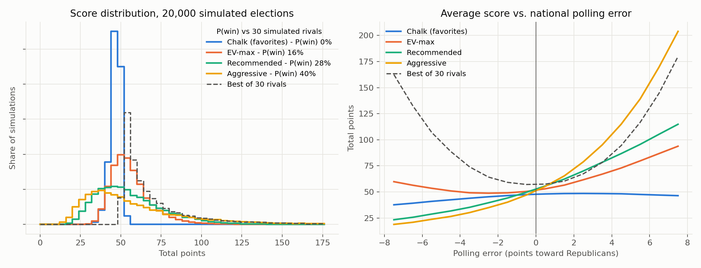

# Model Citizens 2026 — Full Congress Track

Picks for all 470 races (435 House, 35 Senate) in the Model Citizens forecasting competition.

The contest does not reward accuracy. It rewards points, and only the top total wins. So this
repo answers two questions in order:

1. **What is the chance each candidate wins?** A blended model of Kalshi prices, expert ratings, and polls.
2. **Which picks give us the best chance to finish first?** A correlated election simulator, a simulated
   field of rival entrants, and an optimizer that maximizes P(win), not expected points.



## The scoring rule, and why it changes everything

A correct pick earns `-log2(p)` points, where `p` is Kalshi's Nov 1 price for that pick (floored at 1%).
A wrong pick earns 0.

If Kalshi were perfectly calibrated, picking the underdog would **always** have the higher expected score.
The underdog only needs a small true chance to break even:

| Kalshi price of underdog | Points if right | Break-even true probability |
|---:|---:|---:|
| 1% | 6.64 | 0.22% |
| 3% | 5.06 | 0.86% |
| 10% | 3.32 | 4.4% |
| 25% | 2.00 | 17.2% |
| 40% | 1.32 | 35.8% |

But expected points is the wrong target. This is a winner-take-all contest, and races are correlated:
a national polling miss moves dozens of races together. Picking favorites ("chalk") gives a steady
~47 points and almost never wins. To win, you need a big score in the scenarios where rivals do not get one.

## Data

| Source | Use | File |
|---|---|---|
| Kalshi API (pulled 2026-11-02 07:00 UTC = Nov 1, 11 PM Pacific) | Benchmark prices; one market per race | `data/kalshi_prices.csv`, `data/raw/` |
| Kalshi historical API | Nov 1, 2024 prices vs. results (calibration check) | `data/backtest_2024.csv` |
| Cook, Inside Elections, Sabato, Silver Bulletin, Economist, DDHQ, Split Ticket, FiftyPlusOne, Fox, RCP (via Wikipedia, Oct 27–Nov 1) | Expert/model ratings, all 470 races | `data/research/*_ratings.csv` |
| RCP, DDHQ, FiftyPlusOne, Silver, 270toWin | Senate polling averages | `data/research/senate_polls.csv` |
| Generic ballot, approval, specials | Context | `data/research/national.csv` |
| Same-party, uncontested, runoff, RCV cases | Odd cases | `data/research/odd_cases.csv` |

Kalshi covers 461 races. The other 9 are same-party California contests (8 D-vs-D, CA-40 R-vs-R), so the party is certain.

## Method

### 1. Win probabilities (`src/model.py`)
Each race is two-sided: a left candidate (Democrat, or an independent running in the Democrat's place,
like Osborn in NE) and a right candidate. We blend three signals in log-odds space:

- **Market (weight 0.60):** Kalshi price, normalized, then de-biased for the favorite-longshot bias:
  `logit(q) = 1.10 · logit(p)`.
- **Ratings (0.25):** the average of up to 10 raters, each category mapped to its historical hit rate
  (Safe 99.5%, Likely 95%, Lean 83%, Tilt 65%, Toss-up 50%).
- **Polls (0.15, Senate):** polling-average margin through a normal error with sd 6 points.

Forecast combination beats any single source on average. The biggest gaps: Kalshi prices Democrats at
25–45% in five redrawn North Carolina seats that every rater calls Likely or Safe R.

### 2. Correlated simulator (`src/simulate.py`)
A Gaussian factor model. Each race's margin = expected margin + national swing (sd 3 pts) + census-division
swing (1.5) + state swing (2, shared by Senate and House) + a Hispanic-voter swing for 20 districts (3)
+ race noise (House 5, Senate 4). Expected margins are set so each race keeps exactly its model probability.

### 3. Simulated rivals (`src/strategies.py`)
Rivals build noisy beliefs around the market and then pick in one of four ways: favorites, favorites plus
a few upsets, expected-points maximizers, or all underdogs. We test three mixes (naive, mixed, savvy) and
10, 30, or 100 rivals.

### 4. Optimizer
Greedy coordinate ascent on a smoothed P(win) = mean Φ((our score − best rival score)/0.5) over 20,000
simulated elections. Every result below is scored on a **fresh** set of 20,000 elections.

## Results

P(finish first) against 30 rivals ("mixed" field), under five versions of the truth:

| Strategy | Contrarian picks | Our model | Kalshi at face value | Strong longshot bias | Dems +2 | GOP +2 |
|---|---:|---:|---:|---:|---:|---:|
| Chalk (favorites) | 0 | 0.5% | 0.0% | 0.8% | 0.4% | 0.4% |
| EV-max (≥5% only) | 79 | 15% | 3% | 8% | 10% | 16% |
| **Recommended** (P(win)-optimized, ≥3% only) | 56 | **26%** | 5% | **22%** | **15%** | **32%** |
| Aggressive (no floor) | 250 | 39% | 31% | 27% | 18% | 62% |

Full tables: `output/final_eval.csv`, `output/robustness.csv`, `output/sensitivity.csv`.

What the optimizer learned:
- **Take one side of the correlated national error.** Rivals who back underdogs on both sides ("straddlers")
  crowd the Democratic-overperformance scenarios. The Republican-overperformance corner is empty. The
  optimizer's picks back the Republican in every D-leaning race where the Republican has a real chance
  (TX, OH, ME, AK, MI, KS, NH, MN Senate; 47 House seats).
- **Keep favorites in safe seats.** Safe-seat underdogs are mostly noise and give up ~20 near-certain points.
- **The finding holds** across field mixes, rival counts, and national-swing sizes of 2–4 points. With
  rivals who already bet one way (`contrarian` field), P(win) drops but the direction stays.

### Why "Recommended" and not "Aggressive"
Aggressive has the highest simulated P(win), but it picks the Republican in 455 of 470 races. The rules
reject models like "always pick the Democrat". Recommended never picks a candidate our model gives under 3%,
keeps the Democrat in 201 safe-D seats, and still beats chalk by ~50x.

## Strategy ideas we tested

1. **Chalk** — pick every favorite. Low risk, near-zero chance to win.
2. **Expected-points max** — pick the underdog when `q·points` is higher. Wins often, but spreads bets in both directions.
3. **Upset threshold** — favorites plus underdogs above 10/20/30%.
4. **Wave bets** — back one party everywhere it has ≥5% or ≥15%.
5. **P(win) optimization** — search pick sets against a simulated field (our choice, with a credibility floor).
6. **Credibility floor** — never pick a candidate the model gives <3–5%.

## How to run

```bash
pip install -r requirements.txt
./run_all.sh
```

`run_all.sh` pulls fresh Kalshi prices, rebuilds probabilities, writes the four pick files to `output/`,
re-scores them, and redraws the chart. Takes about 3 minutes.

## Files
- `output/picks_recommended.csv` — **submission** (template format)
- `output/picks_{aggressive,ev_credible,chalk}.csv` — alternatives
- `output/detail_*.csv` — each pick with its Kalshi price, points if right, and model probability
- `output/model_probs.csv` — model probability for every race

## Risks and limitations
- **One-direction bet.** Recommended scores poorly if Democrats beat their polls. That is the price of a real chance to win.
- **The field is a guess.** We do not know how many rivals there are or how they pick. We test several mixes.
- **Tail calibration.** We cannot measure Kalshi's longshot bias well: the 2024 Kalshi backtest has only 42 races.
- **Ratings lag.** Expert ratings move slowly; they may understate a wave.
- **Price timing.** Our prices are a Nov 1 snapshot; the organizers' snapshot may differ by a few cents.
- `win_probability` is our model's chance for the candidate we picked. For contrarian picks it is below 50% by design.
